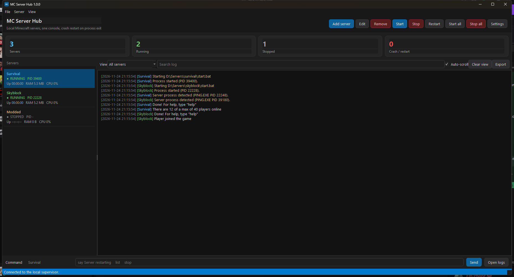

# MC Server Hub

[Tiếng Việt](README.vi.md)

Windows desktop app for running several Minecraft servers on one machine. Each server keeps the BAT file you already use. The hub does not rewrite it.

It puts every console in one window, sends a command to the server you selected, and starts a server again when its process exits. A quiet log is not treated as a crash.



## Features

| | |
| --- | --- |
| Many servers | Add, edit, remove, start, stop, and restart any number of BAT files. |
| One console | Timestamp, server name, color, filter, search, auto-scroll, clear, and export. |
| Right process | CPU, RAM, PID, and uptime come from that server's process tree. |
| Crash restart | Detects process exit, answers `pause`, then restarts with your delay and attempt limit. |
| Commands | `list`, `say`, `op`, and `stop` go to that server's stdin only. |
| Portable | PyInstaller `--onedir` build. Config and logs sit beside the exe. |

## Install

The computer that only runs servers does not need Python. It does need the Java build your BAT file already calls.

Download or build `dist/MCServerHub/`, then copy that whole folder to the server machine and run `MCServerHub.exe`.

From source, on Windows 10 or 11 64-bit with Python 3.11+:

```bat
python -m pip install -r requirements.txt
python -m mc_server_hub.main
```

Build the exe:

```bat
build.bat
```

`build.bat` installs dependencies and runs PyInstaller `--onedir --windowed`. The executable is `dist/MCServerHub/MCServerHub.exe`. A rebuild does not replace an existing `config/servers.json` next to the exe.

PyInstaller may warn that `ext-ms-win-uiacore-*.dll` was not found while packing `OpenConsole.exe`. Those names are Windows API sets. The packaged exe still captures BAT output.

## Add a server

1. Choose **Add server**.
2. Set the display name, the `.bat` or `.cmd` path, and the working directory. The working directory defaults to the folder that contains the BAT file. Point it at the folder that contains `server.jar` when that is where you already start the server.
3. Set auto restart, the delay, and the maximum number of attempts. Unlimited is available per server.
4. Leave **Start when the supervisor launches** off unless this server should come up with the background supervisor.

`config/servers.example.json` shows the saved shape. The app's own `config/servers.json` starts empty.

A BAT file should keep Java as a child of `cmd.exe`. Do not use `start` to detach it, or the hub cannot read the log or stop the tree.

```bat
@echo off
java -Xms2G -Xmx4G -jar server.jar nogui
pause
```

See `examples/start-server.bat`.

## Console

```text
[2026-11-24 15:30:01] [SURVIVAL] Done! For help, type "help"
```

The window keeps 5000 lines. Older lines stay in `logs/<server>/`. **Clear view** does not delete those files.

The command box writes to the selected server. `stop` and `end` count as a user stop, so auto restart does not bring the server back. A command is never forwarded to another server.

## Process model

```text
window  --localhost JSON-->  supervisor  --ConPTY-->  cmd.exe /c call server.bat
                                  |
                                  +-- Job Object (kill on close)
                                         |
                                         +-- java.exe
```

The window does not own the game processes. A supervisor process does. That split is what makes "keep servers running" real:

- **Keep servers running** closes the window. The supervisor, consoles, and restart schedule stay up. Opening the app again attaches to that supervisor.
- **Stop all servers** asks each server to stop, waits for the save, then ends any process still in the tree. The supervisor exits after that.
- Minimize to tray hides the window. **Quit** in the tray menu is what asks the close question.
- Ending the supervisor from Task Manager closes the job, so Java started by the hub exits with it. A server is not left running with nobody watching it.

From source the supervisor is `python -m mc_server_hub.main --supervisor`. In the exe it is `MCServerHub.exe --supervisor`.

Crash detection watches the process tree:

- The Java process exited, or the non-Java child that the BAT actually started.
- `cmd.exe` exited.
- The BAT is sitting on `Press any key to continue`. The hub records that line, sends Enter, waits for the BAT to finish, and then marks the server `CRASHED` unless you pressed Stop.

Auto restart waits the configured delay, then starts the same BAT. The attempt counter resets after the server has stayed up for 120 seconds. When the maximum is reached the status becomes `ERROR` and the hub stops trying. A user stop never increments that schedule.

## Data

| Path | Purpose |
| --- | --- |
| `config/servers.json` | Servers you added. Safe to edit while the app is closed. |
| `config/settings.json` | Theme, defaults, close behavior, log retention. |
| `logs/<server>/YYYY-MM-DD.log` | Full server log. |
| `logs/crash_history.json` | Crash records. |
| `data/supervisor.json` | Port and token while the supervisor is running. Do not publish this file. |

These paths are next to `MCServerHub.exe` in a packaged build, and next to the repository root when you run from source. Nothing the user should edit is stored under `_internal`.

## Development

```bat
python -m pip install psutil pywinpty
python -m unittest discover -s tests -t .
```

The tests start real BAT files: two servers at once, isolated commands, `pause`, a killed child, restart limits, a user stop, and job-object shutdown. They do not download or launch a Minecraft jar.

See [CONTRIBUTING.md](CONTRIBUTING.md) before changing process code.

## License

The source in this repository is [MIT](LICENSE). Minecraft is a trademark of Mojang Synergies AB, and this project is not affiliated with Mojang or Microsoft. Qt, shipped through PySide6, remains LGPL. Details are in [NOTICE.md](NOTICE.md).
