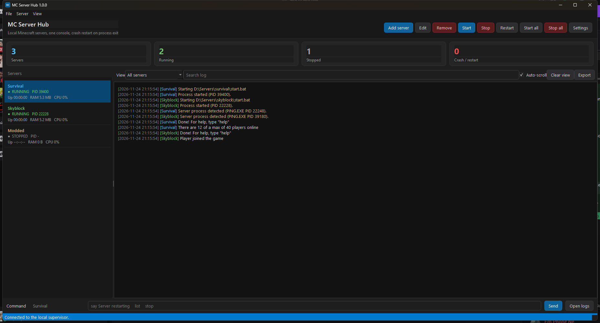

# MC Server Hub

[English](README.md)

Ứng dụng desktop Windows để chạy nhiều Minecraft server trên một máy. Mỗi server vẫn dùng file `.bat` hoặc `.cmd` sẵn có. Hub không sửa nội dung file đó.

Log của mọi server nằm trong một cửa sổ. Lệnh được gửi đúng vào server đang chọn. Server được khởi động lại khi process thoát, không phải khi console im lặng.



## Tính năng

- Thêm, sửa, xóa, chạy, dừng và khởi động lại không giới hạn số server.
- Console chung: thời gian, tên server, màu, lọc, tìm kiếm, tự cuộn, xóa khung nhìn, xuất file.
- CPU, RAM, PID và uptime lấy từ đúng cây process của server đó.
- Phát hiện crash bằng vòng đời process, kể cả BAT đang dừng ở `pause`.
- Tự restart theo delay và số lần tối đa của từng server.
- Bản PyInstaller `--onedir`. Config và log nằm cạnh file exe.

## Cài và chạy

Máy chỉ để chạy server không cần Python. Java vẫn là Java mà file BAT của bạn đang gọi.

Copy cả thư mục `dist/MCServerHub` sang máy Windows 10/11 64-bit và mở `MCServerHub.exe`.

Từ source, với Python 3.11 trở lên:

```bat
python -m pip install -r requirements.txt
python -m mc_server_hub.main
```

Đóng gói:

```bat
build.bat
```

File ra là `dist/MCServerHub/MCServerHub.exe`. Build lại không ghi đè `config/servers.json` đã có cạnh exe.

PyInstaller có thể báo thiếu `ext-ms-win-uiacore-*.dll` khi gói `OpenConsole.exe`. Đó là API set của Windows. Bản exe vẫn nhận output của BAT.

## Thêm server

1. **Add server**.
2. Tên hiển thị, đường dẫn `.bat` hoặc `.cmd`, và working directory. Mặc định là thư mục chứa file BAT. Nếu bạn vẫn khởi động server từ thư mục chứa `server.jar`, hãy chọn thư mục đó.
3. Auto restart, thời gian chờ, số lần tối đa hoặc unlimited.
4. **Start when the supervisor launches** chỉ bật khi server phải tự chạy lúc supervisor khởi động.

`config/servers.example.json` là mẫu. `config/servers.json` lúc mới clone thì trống.

BAT cần để `java.exe` là process con. Đừng dùng `start` để tách Java ra khỏi console, vì hub sẽ không đọc được log và không tắt được cả cây process.

```bat
@echo off
java -Xms2G -Xmx4G -jar server.jar nogui
pause
```

Xem `examples/start-server.bat`.

## Console và lệnh

```text
[2026-11-24 15:30:01] [SURVIVAL] Done! For help, type "help"
```

Cửa sổ giữ 5000 dòng. Phần cũ hơn nằm trong `logs/<server>/`. **Clear view** không xóa file log.

Ô lệnh ghi vào stdin của server đang chọn. `stop` và `end` là lệnh dừng của người dùng, nên auto restart không bật lại server. Lệnh không được chuyển sang server khác.

## Process

Cửa sổ không giữ process game. Supervisor nền mới là process chủ.

- **Keep servers running:** đóng cửa sổ, supervisor và server vẫn chạy. Mở lại ứng dụng sẽ nối vào supervisor đó.
- **Stop all servers:** gửi dừng, chờ server lưu, rồi kết thúc process còn lại. Supervisor thoát sau đó.
- Thu nhỏ xuống tray chỉ ẩn cửa sổ. **Quit** trong menu tray mới hỏi cách xử lý server.
- Tắt supervisor bằng Task Manager sẽ đóng Job Object, nên Java do hub tạo cũng thoát. Không còn Java chạy mà không có process nào giám sát.

Từ source, supervisor là `python -m mc_server_hub.main --supervisor`. Trong exe, đó là `MCServerHub.exe --supervisor`.

Hub coi là crash khi process Java hoặc process con của BAT thoát, khi `cmd.exe` thoát, hoặc khi BAT dừng ở `Press any key to continue`. Với `pause`, hub ghi log, gửi Enter, đợi BAT kết thúc, rồi chuyển `CRASHED` nếu bạn không bấm Stop.

Auto restart chờ đúng delay đã cấu hình rồi chạy lại BAT. Bộ đếm được xóa sau khi server đứng vững 120 giây. Hết số lần thì trạng thái là `ERROR`. Stop chủ động không được lên lịch chạy lại.

## Dữ liệu

| Đường dẫn | Việc nó làm |
| --- | --- |
| `config/servers.json` | Danh sách server. Sửa khi ứng dụng đã tắt. |
| `config/settings.json` | Giao diện, mặc định, cách đóng, thời gian giữ log. |
| `logs/<server>/` | Log đầy đủ và file crash. |
| `logs/crash_history.json` | Lịch sử crash. |
| `data/supervisor.json` | Cổng và token lúc supervisor đang chạy. Không đưa file này lên Git. |

Trong bản đóng gói, các thư mục này nằm cạnh `MCServerHub.exe`, không nằm trong `_internal`.

## Phát triển

```bat
python -m pip install psutil pywinpty
python -m unittest discover -s tests -t .
```

Test khởi động BAT thật: hai server, lệnh không đi nhầm, `pause`, kill process con, giới hạn restart, stop chủ động, và tắt cây process bằng Job Object. Test không tải Minecraft.

Đọc [CONTRIBUTING.md](CONTRIBUTING.md) trước khi sửa phần process.

## Giấy phép

Source trong repository này là [MIT](LICENSE). Minecraft là thương hiệu của Mojang Synergies AB. Project không thuộc về và không được Mojang hay Microsoft bảo trợ. Qt, đi kèm qua PySide6, vẫn là LGPL. Chi tiết nằm trong [NOTICE.md](NOTICE.md).
